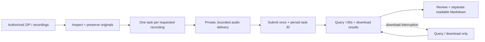

# Doubao Voice Minutes / 语音妙记 Playbook

Use for native transcription **and** meeting summaries, not plain Flash ASR. Keep this playbook in `agent-skills/skills/doubao-tts/`; keep recordings, transcripts, credentials and per-run receipts outside the skill.

## Route and source contract



- Inspect the current upload before asking the user to repeat context. List ZIP members, reject path traversal, probe audio duration/codec/channels and record hashes.
- Keep recordings separate unless the current request explicitly says to merge. Do not reprocess clips already transcribed. Filenames and embedded creation time do not prove the meeting date or participants.
- Cloud processing is metered. Confirm the exact authorized recordings, do not activate/purchase services or change provider for convenience. Do not assume the Doubao app and API have the same billing.
- API limits documented here: file <1 GB, duration up to 2 hours, audio MP3/WAV/AAC/FLAC/OGG. Recheck official docs when a limit affects the task. M4A is not listed: use an AAC remux or a clearly marked recognition copy.

## Authentication and endpoints

Load the existing credential privately. New-console `DOUBAO_API_KEY` (aliases `DOUBAO_SPEECH_API_KEY`, `DOUBAO_TTS2_API_KEY`) uses `X-Api-Key`. Resolve the current host's secrets source; never execute another machine's absolute paths blindly. An established Linux source can be `~/.agents/secrets/bytedance-volcengine-doubao.env`; never print its values.

```text
POST https://openspeech.bytedance.com/api/v3/auc/lark/submit
POST https://openspeech.bytedance.com/api/v3/auc/lark/query
Content-Type: application/json
X-Api-Key: <existing new-console key>
X-Api-Resource-Id: volc.lark.minutes
X-Api-Request-Id: <UUID, persisted for tracing>
X-Api-Sequence: -1
```

Do not substitute `/auc/bigmodel/recognize/flash`: Flash does not return native minutes. Legacy app/access headers differ from new-console API-key authentication; do not interchange credentials.

## Established useful parameters

Liz's default: Chinese transcription, automatic speaker IDs, word times, full summary, chapter summaries, todo and Q&A. No English translation or unrelated extras.

```json
{
  "Input": {
    "Offline": {"FileURL": "<private temporary source URL>", "FileType": "audio"}
  },
  "Params": {
    "AllActivate": true,
    "SourceLang": "zh_cn",
    "AudioTranscriptionEnable": true,
    "AudioTranscriptionParams": {
      "SpeakerIdentification": true,
      "NumberOfSpeaker": 0,
      "NeedWordTimeSeries": true,
      "HotWords": ""
    },
    "TranslationEnable": false,
    "InformationExtractionEnabled": true,
    "InformationExtractionParams": {"Types": ["todo_list", "question_answer"]},
    "SummarizationEnabled": true,
    "SummarizationParams": {"Types": ["summary"]},
    "ChapterEnabled": true
  }
}
```

`AllActivate` means **bundled billing**, not automatic activation of every feature. Features are selected individually. Preserve the established billing mode unless current official pricing and the chosen features justify changing it; do not set it false merely because the user says “don't turn everything on.” `NumberOfSpeaker=0` is automatic detection, not proof the speaker count is correct. Use a known count only when the user supplies one.

## Audio delivery: don't repeat the slow-tunnel failure

1. Preserve original bytes. For compatible AAC inside M4A, prefer `ffmpeg -i input.m4a -map 0:a:0 -c:a copy -f adts source.aac`. This remux does not re-encode. ADTS adds headers: compare normalized payloads using `aac_adtstoasc` when proving encoded-audio identity, not whole-file hashes.
2. If size/network is the actual bottleneck, make a separate recognition copy, e.g. mono 16 kHz AAC-LC at an appropriate speech bitrate. Probe duration and decode the entire copy locally. Record its hash/encoding and disclose lossy conversion; never call it lossless. Do not assume an untested lower bitrate is a verified quality improvement.
3. Prefer an **already-authorized** private object URL with short expiry. Do not broaden storage scope, publish a bucket, modify production ingress or add a new paid service just for transport.
4. If using a temporary HTTP server, expose only exact high-entropy paths, never a folder listing. Bind to loopback behind a temporary tunnel; log byte counts/completion without capability paths. Support HEAD and byte ranges. Keep API credentials on the caller, not on an auxiliary file relay.
5. Wait for a real registered tunnel. Match the generated hostname, **not** `api.trycloudflare.com` inside an error message. An API startup timeout is a pre-submit failure, not an ASR failure. Record stderr privately; test a different authorized route rather than blindly repeating submissions.
6. Test from an independent network with a strict wall-clock budget. HEAD only proves reachability. A small range sample proves those bytes and timing, **not** full-file readiness. For a new/unreliable route, require a full-size SHA256 download within a practical deadline before paid submission; skip redundant full downloads only when the route already has recent equivalent evidence. Socket idle timeout alone is not a wall-clock limit.
7. Stop if throughput cannot deliver the whole file within the provider's practical download window. Quick Tunnel has previously delivered a 35.7 MB recording too slowly and tasks returned 4030. Do not spend many minutes repeatedly pre-downloading through the same slow route. If an already-trusted auxiliary host is authorized for this audio, a task-scoped exact-file relay there can avoid the desktop uplink: keep API keys on the caller, verify full downloads from a second network, impose an automatic lifetime and stop only the task-owned service. This AAC relay pattern has completed real minutes tasks; it is not a guarantee about every host or tunnel.
8. Keep the endpoint alive until tasks settle, then stop the owned processes. Close ports/tunnels and remove temporary relay copies under the task's cleanup authorization; preserve original recordings and useful evidence.

An `unsupported audio format` response does not by itself prove the codec is wrong when the download log shows an incomplete body. Likewise 4030 does not identify the unique timeout cause. Inspect download completeness, local decoding and actual format before choosing a bounded retry. Document candidates as unverified until a task succeeds.

## Submit, poll and recovery

- Use a native background job for long work (systemd/tmux or host equivalent), with known private status/log paths and status/stop commands. Do independent output work while waiting.
- Persist source hash, parameters, request UUID and a **submitting** receipt before the one submit attempt. Save the complete response and task ID immediately. HTTP 200 / `X-Api-Status-Code=20000000` plus `Data.TaskID` means accepted, **not** transcribed.
- Query with `{"TaskID":"<saved ID>"}` at intervals **greater than 30 seconds**. Set an overall query deadline. Save status/error/log IDs privately.
- `Data.Status=success`: download returned `AudioTranscriptionFile`, `ChapterFile`, `InformationExtractionFile`, `SummarizationFile` immediately. Validate JSON, use atomic writes and only then mark local completion. Result URLs can expire.
- `Data.Status=failed`: retain `ErrCode`/`ErrMessage`; establish a corrected cause before any bounded retry. No automatic paid retry loop. A missing submit response is ambiguous: do not assume nothing was billed and resubmit.
- If querying/downloading fails after acceptance or success, recover by **query/download only**, using the saved task ID. Never retranscribe just to recover lost result downloads.

## Result review and delivery

- Inspect actual JSON shape. The transcription is normally a sentence list with `sentence_id`, `content`, millisecond `start_time`/`end_time`, `speaker` and `words`. Word entries carry their own content/start/end; do not infer single-character alignment.
- Check every sentence/word boundary against the original duration, monotonic starts and valid ranges. Report speaker IDs actually returned. IDs are recording-local and are not real names; do not merge the same number across recordings.
- `SummarizationFile` normally contains `paragraph`/`title`; chapters under `chapter_summary`; extraction under `todo_list`/`question_answer`. Chapter nodes can be `type=PARENT` with an empty `summary` and nested `children_paras`: render and validate children recursively, report main/subchapter counts separately, and do not mistake an empty parent body for missing content. Empty optional lists are legitimate. Preserve unrecognized returned fields in private raw JSON.
- Chapter ends have exceeded audio duration in past responses. Preserve and flag the provider values; do not silently clamp them or use them as exact playback cuts.
- Preserve raw transcript wording. Separate **原始转录** from **智能纪要（豆包原始结果）**. Provider summaries, todo and Q&A are generated interpretations, not verified decisions, established agreement or completed work. The contract has no dedicated “key decisions / memorable quotes” fields; do not invent them.
- A retrospective monologue is recollection, not an original interview. Label the distinction when the actual audio supports it; don't infer it from filenames.
- Review **all** transcript/summary/extraction content for spoken passwords, credentials and customer contact details before sharing or repository archival. Keep untouched sensitive originals private; make any redaction explicit and narrow. Do not infer people's real identities.
- Deliver one readable Markdown per requested recording. Keep raw result JSON and provenance/hash metadata privately for audit. Don't create ZIP/SRT/TXT, extra model summaries or worker “精华” by default.
- Downloads is a temporary work area, not the final reference location for business recordings. Once repository archival is explicitly authorized, use the existing canonical private `project-context` checkout and group the event under `sources/<date>-<specific-context>/`, following its current conventions; keep old unrelated paths untouched. Include separate transcripts, byte-preserved reviewed result JSON and safe provenance; exclude source audio, credentials, request/query JSON and serving logs unless specifically requested.
- The event entry should explain **what was discussed**, with concrete product/business search terms supplied by the user, recording-local timestamps, requests versus actual commitments, and unresolved questions. Preserve raw ASR wording and record any display-name normalization separately. Do not turn a sales presentation into verified product facts. If the date is only an upload/import batch date, label it rather than claiming the meeting occurred then.
- Archive business sources only with explicit permission; don't revive duplicate SOP/Radar copies. Personal recordings stay out of business archives. Reusable procedures belong in this skill, private recordings/transcripts do not. Commit/push only when authorized and stage only the task-owned files.
- Request/query JSON and tunnel logs may contain capability URLs; they are **not** safe archive/delivery files. Public skill docs contain only placeholders.

## Completion checks

- Every requested recording has a separate accepted ID and final successful task; every requested native result file has been downloaded and reopened.
- Source originals are unchanged; recognition/remux copies are clearly distinguished. No duplicate successful task or silent fallback provider.
- Counts of sentences, speakers, words, chapters, todo/Q&A are computed from actual results. Timing/anomaly checks and whole-output privacy review are complete, with gaps stated.
- Readable Markdown distinguishes original transcript from generated minutes; result hashes match retained files. Unrequested English translation, extra packaging and repository uploads are absent.
- All owned temporary source endpoints are closed. Auxiliary relay copies are handled under the agreed cleanup scope; a submitted task alone is never reported as finished.

## Primary source

[豆包语音妙记 API 接入文档](https://docs.volcengine.com/docs/DoubaoVoice/DoubaoVoiceMinutes-APIAccessDocumentation?lang=zh) — submit/query, parameter and result contract. Last checked 2026-10-26. Product documentation supports the contract, not a claim that any particular host's credentials or delivery route work.
